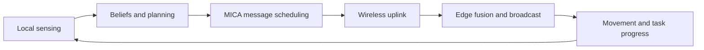

<div align="center">

# MICA

**Multiagent Information Coordination Architecture**

Semantic communication and collaboration for heterogeneous agent teams.

[](https://github.com/NyxFelineLabs/mica-comm/actions/workflows/ci.yml)
[](pyproject.toml)
[](LICENSE)

**English** · [简体中文](README.zh-CN.md)

[Quick Start](#quick-start) · [Experiments](#experiments) · [Results](#measured-results) · [Documentation](#documentation)

</div>

---

## Overview

MICA studies **what agents should communicate, when, and at what transmission
rate** under wireless resource constraints. Search-and-rescue missions combine
local sensing, shared beliefs, classical or LLM planners, and task-aware message
scheduling in one reproducible simulator.

| Layer | Included |
| --- | --- |
| Team | Classical planners and optional Ollama-backed LLM agents |
| Communication | Evidence, intentions, confirmations, fading links, and rate selection |
| Evaluation | Fixed seeds, baselines, ablations, held-out calibration, and resource accounting |



The project and framework are both called **MICA**. The repository and Python
distribution are `mica-comm`; the import package is `mica_comm` and the primary
policy ID is `mica`.

## Quick Start

Python 3.9+ is required. The default mission needs no LLM server or GPU.

```bash
git clone https://github.com/NyxFelineLabs/mica-comm.git
cd mica-comm
python -m venv .venv
source .venv/bin/activate
python -m pip install -e ".[dev]"
python -m mica_comm.simulator --scheme mica --seed 0
```

On Windows PowerShell, activate with `.\.venv\Scripts\Activate.ps1`. With an
existing environment, skip environment creation and install using that Python.

The default seed-0 mission completes in **122 slots** and uses **13,304 uplink
symbols**. These values are a software regression check, not a performance claim.
The installed command `mica-mission --scheme mica --seed 0` is equivalent.

<details>
<summary><strong>Python API</strong></summary>

```python
from mica_comm import Config, run_episode

config = Config().with_(symbols_per_slot=50)
result = run_episode(config, scheme="mica", seed=0)
print(result["completion_time"], result["symbols"])
```

</details>

## Experiments

Run these commands from the repository root with the environment activated.

| Goal | Command |
| --- | --- |
| Baseline smoke run | `python -m experiments.run_all --only default --seeds 2` |
| Communication ablations | `python -m experiments.run_robustness --only ablation --seeds 2` |
| Classical teammate calibration | `python -m experiments.run_behavior_calibration --train-seeds 16 --eval-seeds 30 --workers 4` |
| LLM teammate calibration | `python -m experiments.run_llm_calibration --models qwen3:8b llama3.1:8b` |

The LLM calibration command requires both model tags to be installed in Ollama.
It fits on separate training seeds, freezes the parameters, and compares the
original and calibrated softmax **within each model**. Each team has three LLM
agents and three classical planners. Backend fallbacks stop the experiment.

For WSL calling Windows Ollama, see the [LLM experiment protocol](docs/llm_behavior_calibration.md),
including its existing-Python bridge. The general client uses `MICA_OLLAMA_URL`
with a full `/api/generate` URL; the calibration runner accepts `--url` with the
server's base URL. See [model backends](docs/model_backends.md) for aliases and caches.

Generated data stays local and is ignored by Git:

```text
results/    Per-seed records, summaries, frozen calibration, and LLM response caches
figures/    Generated analysis figures
```

Use `MICA_RESULTS_DIR`, `MICA_FIGURES_DIR`, and `MICA_CACHE_DIR` to redirect the
standard output locations. Compare policies with the same configurations and
seed sets; separate simulated slots from inference wall time.

## Measured Results

> **Current finding:** softmax calibration saves communication in the tested LLM
> teams, but does not establish an overall efficiency gain. It remains opt-in.

The following changes are relative to the original softmax with the **same
model**, using 12 paired seeds per scenario. Higher completion slots mean slower
missions. All 96 evaluation missions completed with zero backend fallbacks.

| Model | Scenario | Mean uplink symbols | Mean completion slots |
| --- | --- | ---: | ---: |
| Qwen3 8B | Default | −23.6% | +23.2% |
| Qwen3 8B | Clustered | −28.5% | +19.2% |
| Llama 3.1 8B | Default | −35.5% | +33.0% |
| Llama 3.1 8B | Clustered | −40.7% | +10.6% |

These are exploratory means, not four statistically established slowdowns.
The Llama default slot interval excludes zero; the other three include zero.
Read the [full LLM report](docs/llm_behavior_calibration_results.md) for paired
intervals, prediction diagnostics, cache accounting, and limitations. The
[classical-planner report](docs/behavior_calibration_results.md) covers the
separate classical experiments. Cached execution does not measure online speedup.

## Project Structure

```text
mica-comm/
├── src/mica_comm/       Simulator, planners, channels, messages, and MICA schedulers
├── experiments/         Experiment runners, analysis, and plotting
├── scripts/             Focused mission and cache utilities
├── tests/               Unit and regression tests
├── docs/                Architecture, protocols, and measured results
└── .github/workflows/   Continuous integration
```

Keep reusable methods in `src/mica_comm/` and campaign orchestration in
`experiments/`. Generated responses and mission outputs do not belong in commits.

## Documentation

| Guide | Contents |
| --- | --- |
| [Architecture](docs/architecture.md) | Simulation loop, modules, and extension points |
| [Experiment Workflow](docs/experiments.md) | Sweeps, policy IDs, fair comparisons, and outputs |
| [Model Backends](docs/model_backends.md) | Ollama, model aliases, and response caches |
| [Behavior Calibration](docs/behavior_calibration.md) | Receiver softmax fitting and assumptions |
| [LLM Calibration](docs/llm_behavior_calibration.md) | Held-out evaluation and Windows/WSL inference |
| [Contributing](CONTRIBUTING.md) | Development conventions and checks |

Development checks:

```bash
black --check src tests experiments scripts
ruff check src tests experiments scripts
python -m pytest -q
```

**Upgrading an existing checkout:** imports, the console command, and project
environment variables now use `mica_comm`, `mica-mission`, and `MICA_`.
Reinstall the editable package and update your shell configuration. Existing
results are retained; source-hash-checked campaigns require a fresh output
directory after this rename.

## License

MIT. See [LICENSE](LICENSE) and [NOTICE](NOTICE.md) for copyright and source
attribution. Record the code revision, configuration, model digest, and seed set
when publishing experimental results.
