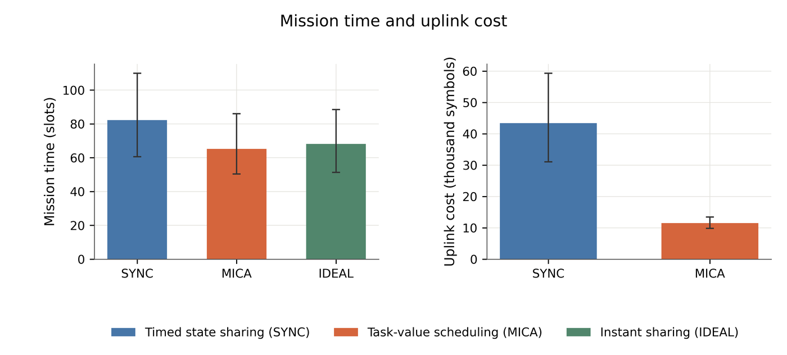
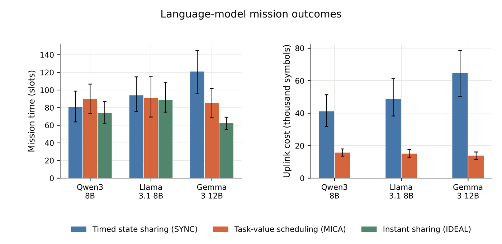

<div align="center">

# MICA

**Multiagent Information Coordination Architecture**

Task-oriented semantic communication for heterogeneous agent teams

[](https://github.com/NyxFelineLabs/mica-comm/actions/workflows/ci.yml)
[](pyproject.toml)

**English** · [简体中文](README.zh-CN.md)

[Quick start](#quick-start) · [Structure](#structure) · [Results](#results) · [Figure catalog](reports/current/README.md)

</div>

**Current main baseline:** three planners + three different LLMs. Completed and validated 1380 missions with zero backend fallbacks. [Results and Table XII](reports/current_mixed/README.md) · [Bilingual figures](reports/current_mixed/FIGURES.md).


---

## Overview

MICA studies **which semantics to transmit, when communication is useful, and how to allocate limited channel resources** in grid-based search and rescue. Agents use local observations to find hidden targets and exchange confirmations, evidence, and search intentions. Communication changes subsequent search decisions.

The executable missions use a task-value scheduler: predict the effect of a message on teammates' search utility, then account for delivery probability and symbol cost when selecting messages and transmission rates. Agents support classical planners and local LLMs through Ollama. The on-demand evidence components in `demand/` have protocol tests but are not integrated into a full mission loop.

The default `mica` policy uses the EToM value model (`voi_mode="etom"`). `mica_ptr` (public task relevance) scores the counterfactual change in searchable survivor mass, weighted by publicly reported receiver accessibility, without predicting receiver policies or reading private receiver state. `mica_twig` is a Bayesian-surprise alternative, and `mica_ig` removes its accessibility weighting as an ablation. Compare these value modules at matched seeds and then tune the price for each module; a shared price is not a fair resource comparison:

```bash
python -m experiments.run_value_ablation --seeds 12 --workers 6
```

The custom **EToM** variant (Efficient Theory of Mind for Task-Oriented Semantic Communication) is the project-wide default value model. Its default calibrated parameters are temperature `0.2` and public-intent persistence `2.0`. The tradeoff experiment can tune receiver-specific values and radio price on training and tuning seeds, then evaluate on untouched seeds. The joint score weights normalized mission time against normalized total symbols; `--time-weight 0.8` gives time 80% and symbols 20%. EToM is a method name introduced in this project, not an established method from the source paper. The current evaluation measures mission time and communication symbols, while computation efficiency remains a design goal to measure separately. The previous 30-seed comparison remains in `results/etom_tradeoff_time80/summary.json`: the selected setting reduced total symbols by 12.4% and increased mission time by 8.5%; the paired interval for time includes zero.

```bash
python -m experiments.run_etom_tradeoff --workers 6 --time-weight 0.8
```

The main baseline is now **three classical planners plus three different LLMs in the same mission**: agents 0, 2, and 4 use `qwen3:8b`, `llama3.1:8b`, and `gemma3:12b`, respectively. The current EToM value model and exact dynamic-programming scheduler are used throughout. The complete campaign has 112 configuration cells, plus three optional Table XII reference cells, each evaluated on the same 12 seeds. Team-size sweeps keep the three LLM agents and vary the number of planners (6, 8, 10, 12, 14 agents total).

```bash
python -m experiments.run_current --table-xii --seeds 12 --workers 6 --output results/current_mixed_20261019
python -m experiments.summarize_current --input results/current_mixed_20261019
```

The Table XII extension uses orthogonal uplinks with 100 symbols per agent per slot. It mixes three models in one team, so it is an extension of the paper protocol rather than a reproduction of its original model tags or numerical results. Reports include paired periodic-minus-MICA time differences, periodic/MICA uplink ratios, bootstrap intervals, full resource accounting, per-agent model identities, inference counters, and backend fallback checks. Resume requires identical source, model digests, configuration, and seed cohorts.

The current campaign design (`experiments/run_current.py`) enables a shared uplink budget of 300 symbols per slot across six agents. Search defaults to static equal shares (50 symbols per agent), which need no scheduling requests or grants; rescue defaults to the paper's broadcast-price coordinator. Paired search and rescue experiments compare both with a central coordinator. Static shares cannot borrow unused capacity from another agent; compare mission outcomes and total communication cost together. Plain `Config()` retains orthogonal uplinks for legacy runs.

## Quick start

Use your existing Python environment in WSL. Install this project in editable mode once:

```bash
python -m pip install -e ".[dev]"
mica-mission --scheme mica --seed 9000
python -m pytest -q
```

Default missions use the three-model mixed team and require Ollama. Use `mica-mission --team planner` for a planner-only diagnostic. For online model experiments, point the endpoint at Windows Ollama; replace localhost with the Windows host address if needed from WSL.

`mica-mission` now uses a shared 300-symbol uplink with static equal shares by default. Use `--shared-mode price` for the paper's dynamic coordinator, or `--shared-budget 0` for the earlier orthogonal setup.

```bash
python -m experiments.run_team_benchmark --help
python -m experiments.run_team_benchmark --url http://localhost:11434 \
  --seeds 12 --output results/team_new
```

Models: `qwen3:8b`, `llama3.1:8b`, and `gemma3:12b`. The default benchmark mixes one agent per model with three classical planners. The earlier comparison using one selected model for all three LLM agents is available explicitly with `--team-mode single_model`.

## Structure

```text
mica-comm/
├── src/mica_comm/
│   ├── core/              # Configuration, paths, source fingerprints
│   ├── world/             # World, beliefs, rescue task
│   ├── agents/            # Planners, LLM client, behavior prediction
│   ├── communication/     # Messages, channel, scheduling, joint selection
│   ├── simulation/        # Mission loop, broadcasts, resource accounting
│   ├── demand/            # On-demand protocol; not mission-integrated
│   ├── evaluation/        # Cohort and configuration validation
│   └── visualization/     # Style, fonts, bilingual labels
├── experiments/           # Runners and analysis
├── scripts/               # Import and cache tools
├── tests/                 # Behavior, protocol, and integrity tests
├── reports/current/       # Outcome snapshots, statistics, figure index
├── figures/current/       # Chinese/English PDF, SVG, PNG figures
└── results/               # Local logs/caches; Git-ignored
```

The `src` layout keeps one `mica_comm` namespace with focused subpackages. Reusable mission and communication logic belongs in the package; experiment runners handle parameters and orchestration. Public API:

```python
from mica_comm import Config, run_episode

config = Config().with_(grid=32, n_agents=6, symbols_per_slot=100)
result = run_episode(config, "mica", seed=9000)
```

## Results

### Historical classical planner teams

The published snapshot below used orthogonal uplinks in its default setting. It predates the shared-budget campaign design and should not be read as its outcome.

On 2026-10-19, **1,272 missions** ran in WSL: 106 configuration cells with the same 12 seeds per cell (9000–9011). Defaults: a $32\\times32$ grid, six agents, eight hidden targets, 100 symbols per agent per slot, 5 dB reference SNR, and a 400-slot horizon.

| Communication policy | Time / slots | Uplink symbols | Total symbols | Completion |
| --- | ---: | ---: | ---: | ---: |
| Timed state sharing (SYNC) | 82.25 | 43,407.83 | 49,734.17 | 100% |
| Task-value scheduling (MICA) | 65.25 | 11,509.25 | 14,658.08 | 100% |
| Instant sharing (IDEAL) | 68.17 | — | — | 100% |

IDEAL bypasses uplink delivery constraints; its zero uplink accounting does not mean zero physical cost. Total symbols include uplink data, requests, broadcasts, feedback, and grants. See [mission metrics](reports/current/metrics.csv) and the [configuration manifest](reports/current/manifest.json).



### Historical single-model LLM teams

These 108 missions generated online responses on 2026-10-18. The refactor replayed our own response caches and verified every mission metric with no new inference requests. Each model-policy cell has 12 seeds (8000–8011); all missions completed without backend fallback.

| Model | SYNC time | MICA time | IDEAL time | SYNC uplink symbols | MICA uplink symbols |
| --- | ---: | ---: | ---: | ---: | ---: |
| Qwen3 8B | 80.58 | 89.83 | 73.92 | 41,115.25 | 15,687.00 |
| Llama 3.1 8B | 93.83 | 90.75 | 88.58 | 48,761.83 | 15,094.08 |
| Gemma 3 12B | 120.92 | 85.00 | 62.25 | 64,759.17 | 13,837.67 |

Time means **simulation slots**, not inference seconds. Gemma has 12B parameters; the other models have 8B. These outcomes do not establish parameter-scale or inference-compute efficiency. See [LLM statistics](reports/current/llm/summary.json).



## Figures and reproduction

The [bilingual catalog of 18 figure topics](reports/current/README.md) covers time/cost, progress, team size, budgets, SNR, broadcast reliability, shared resources, finite blocklength, rescue deadlines, tradeoffs, components, trajectories, model differences, and valuation noise. Chinese filenames describe their contents, for example `15_多智能体搜索轨迹.pdf`.

The repository publishes validated result snapshots and final vector figures. The plotting implementation is kept private. To run the full mixed-team campaign for a new study:

```bash
python -m experiments.run_current --table-xii --seeds 12 --workers 6 --output results/current_mixed_new
```

Published bands and error bars are exploratory mission-seed bootstrap 95% intervals without multiplicity adjustment. Unfinished missions retain the horizon time. Figure 13 shows mean budget tradeoffs without claiming global Pareto optimality; the trajectory example uses the first seed.

Earlier local figures are preserved in `results/figure_archive_20261019/`.
