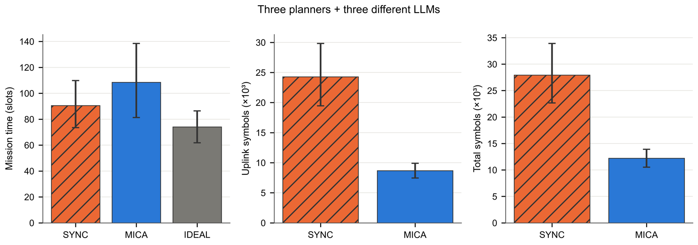

<div align="center">

# MICA

**Multiagent Information Coordination Architecture**

Task-oriented semantic communication for heterogeneous search-and-rescue teams.

[](https://github.com/NyxFelineLabs/mica-comm/actions/workflows/ci.yml)
[](pyproject.toml)

**English** · [简体中文](README.zh-CN.md)

[Overview](#overview) · [Current baseline](#current-baseline) · [Get started](#get-started) · [Repository](#repository)

</div>

## Overview

MICA studies **what agents should share, when they should communicate, and how they should use a limited channel**. In a grid-based search-and-rescue mission, agents observe their surroundings, exchange evidence and intentions, and update their plans from shared information.

The `mica` policy estimates a message's effect on teammates' search decisions, then weighs that value against delivery probability and symbol cost. The implementation supports classical planners and local LLM agents through Ollama. Its default message-value model is EToM, paired with an exact dynamic-programming scheduler.

## Current baseline

The current team combines **three classical planners** with **Qwen3 8B, Llama 3.1 8B, and Gemma 3 12B**. The campaign validated **1,380 missions** across its configurations with **zero backend fallbacks**.

In the representative 12-seed, shared-uplink setting (300 symbols per slot), MICA used **8,686 uplink symbols** on average versus **24,267** for periodic sharing. Mean mission time was **108.5 versus 90.5 simulation slots**, respectively. The lower communication cost came with a longer mean mission time in this setting. See the [full mixed-team results](reports/current_mixed/README.md) for the other configurations and uncertainty intervals.



## Get started

Install with Python 3.9 or newer, then run a planner-only mission without an LLM service:

```bash
python -m pip install -e ".[dev]"
mica-mission --team planner --scheme mica --seed 9000
```

The default mixed team requires Ollama with `qwen3:8b`, `llama3.1:8b`, and `gemma3:12b` available locally. Run `mica-mission --help` for team, channel, and mission options.

## Repository

| Path | Contents |
| --- | --- |
| `src/mica_comm/` | Agents, communication policies, world model, and simulation |
| `experiments/` | Experiment runners and analysis |
| `tests/` | Behavior, protocol, and result-integrity tests |
| `reports/current_mixed/` | Current campaign results and supporting data |

CI runs Black, Ruff, and pytest on every push and pull request using Python 3.11. These checks do not require Ollama; full LLM campaigns run separately.
