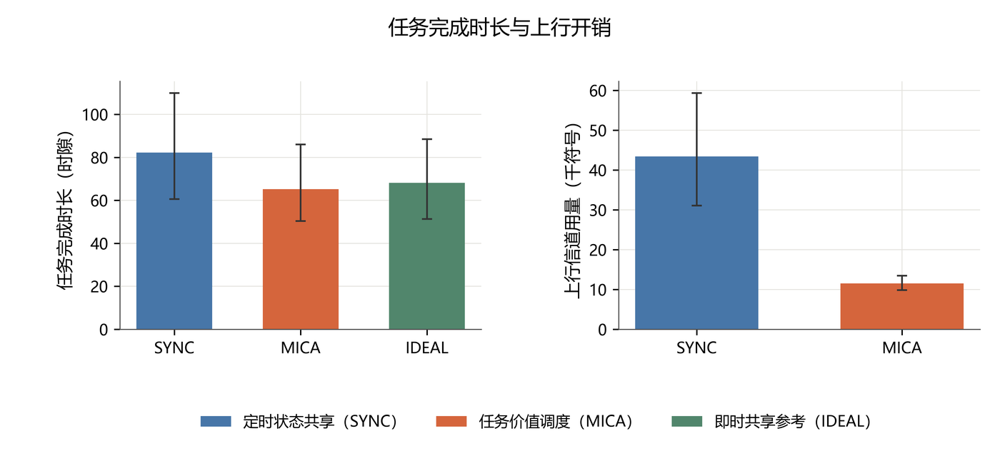
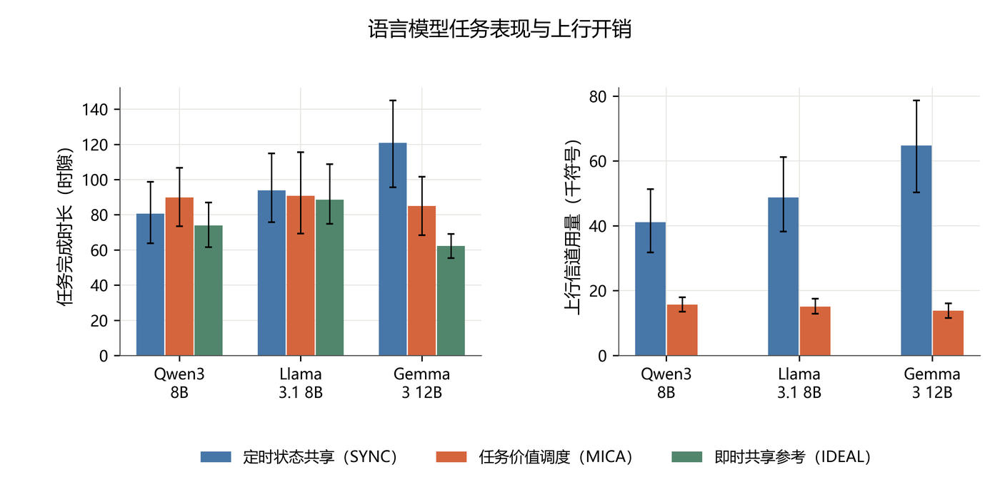

<div align="center">

# MICA

**Multiagent Information Coordination Architecture**

面向异构智能体团队的任务导向语义通信实验平台

[](https://github.com/NyxFelineLabs/mica-comm/actions/workflows/ci.yml)
[](pyproject.toml)

[English](README.md) · **简体中文**

[开始使用](#开始使用) · [项目结构](#项目结构) · [公式与定义](#公式与定义) · [实验结果](#实验结果) · [图表目录](reports/current/README.md)

</div>

---

## 项目概述

MICA 在网格点位搜救任务中研究：**传什么语义、何时值得通信、如何分配有限信道资源**。智能体利用局部观测寻找隐藏目标，交换确认、观测证据与搜索意图；通信会影响团队后续的搜索决策。

当前可执行任务使用任务价值调度器，预测消息对队友搜索效用的影响，结合投递成功率和符号成本选择消息与速率。智能体支持经典规划器和 Ollama 本地 LLM。`demand/` 中的按需证据交互组件仍在协议验证阶段，尚未接入完整任务闭环；本页结果来自已经接通的任务仿真器。

## 开始使用

在 WSL 中使用已有 Python 环境即可；首次安装本项目的可编辑包：

```bash
python -m pip install -e ".[dev]"
mica-mission --scheme mica --seed 9000
python -m pytest -q
```

默认任务无需 LLM 服务。三个本地模型的在线实验如下；从 WSL 无法访问 localhost 时，将地址替换为 Windows 主机地址。

```bash
python -m experiments.run_team_benchmark --help
python -m experiments.run_team_benchmark --url http://localhost:11434 \
  --seeds 12 --output results/team_new
```

模型为 `qwen3:8b`、`llama3.1:8b`、`gemma3:12b`。每次任务由 3 个所选 LLM 智能体和 3 个经典规划智能体组成，不是三个模型同时混编。

## 项目结构

```text
mica-comm/
├── src/mica_comm/
│   ├── core/              # 不可变配置、路径、代码指纹
│   ├── world/             # 网格环境、观测信念、救援任务
│   ├── agents/            # 经典规划、LLM 接口、队友行为预测
│   ├── communication/     # 消息、链路、通信调度与联合选择
│   ├── simulation/        # 任务闭环、广播、资源开销统计
│   ├── demand/            # 按需证据协议组件（尚未接入任务闭环）
│   ├── evaluation/        # 实验队列完整性与配置校验
│   └── visualization/     # 图表样式、字体、中英文支持
├── experiments/           # 实验入口、分析与绘图
├── scripts/               # 数据导入、缓存核验等工具
├── tests/                 # 行为、协议、结果完整性测试
├── reports/current/       # 结果快照、配置、统计与图表索引
├── figures/current/       # 中英文 PDF、SVG、PNG
└── results/               # 本地任务日志与模型缓存（Git 忽略）
```

`src` 保留统一的 `mica_comm` 包名，内部按职责分层。可复用逻辑放入对应子包，实验入口只负责参数与编排。公共接口示例：

```python
from mica_comm import Config, run_episode

config = Config().with_(grid=32, n_agents=6, symbols_per_slot=100)
result = run_episode(config, "mica", seed=9000)
```

## 公式与定义

以下表达式对应当前任务仿真器。默认使用统一温度的队友预测，也支持接收方独立温度与意图持续偏置配置。

| 模块 | 核心表达式 | 含义 |
| --- | --- | --- |
| 网格与团队 | $\mathcal X=\{0,\ldots,G-1\}^2$，$\lvert\mathcal A\rvert=A$，$N_{\mathrm v}$ | $\mathcal X$ 为网格点集合，$\mathcal A$ 和 $A$ 分别为智能体集合及数量，$N_{\mathrm v}$ 为隐藏幸存者数量；$x_a(t)$、$y_a(t)$ 分别为智能体 $a$ 的位置和目标。 |
| 传感证据 | $\kappa_+=\ln\frac{p_{\mathrm{hit}}}{p_{\mathrm{fa}}}$，$\kappa_-=\ln\frac{1-p_{\mathrm{hit}}}{1-p_{\mathrm{fa}}}$ | 检测到目标和未检测到目标时的对数似然增量。 |
| 信念 | $\ell_{a,t}(z)=\ell_t^{\mathrm{sh}}(z)+\epsilon_{a,t}(z)$，$P_{a,t}(z)=\operatorname{sigm}(\ell_{a,t}(z))$ | 共享对数几率与智能体尚未上传的本地证据相加，再转换为目标概率。 |
| 搜索规划 | $B_{a,t}(z)=\sum_{q\in F_{r_{\mathrm s}}(z)}P_{a,t}(q)$；$\Psi_{a,t}(z)=\frac{B_{a,t}(z)}{1+\alpha_d\lVert z-x_a(t)\rVert_1}\prod_{q\in\mathcal Y_{a,t}}\left(1-e^{-\lVert z-q\rVert_2^2/(2\omega^2)}\right)$；$y_a(t)\in\arg\max_z\Psi_{a,t}(z)$ | 以感知区域内的期望目标数为基础，按移动距离和与队友搜索区域的重合程度调整目标得分。 |
| 队友预测 | $\varpi_a(z\mid\mathcal K_t)=\operatorname{softmax}_z\!\left(\frac{\Psi_a(z;\mathcal K_t)}{\tau_a^{\mathrm{tom}}\max_w\Psi_a(w;\mathcal K_t)}\right)$ | 使用归一化得分的 softmax 预测队友目标；$\tau_a^{\mathrm{tom}}>0$ 控制分布集中程度。 |
| 信息价值 | $\mathcal I(m)=\sum_{a\ne s}\left(\mathbb E_{z\sim\varpi_a(\cdot\mid\mathcal K_t\oplus m)}U_a(z;\mathcal B_s)-\mathbb E_{z\sim\varpi_a(\cdot\mid\mathcal K_t)}U_a(z;\mathcal B_s)\right)$ | 发送者 $s$ 发送消息 $m$ 后，队友搜索效用的期望变化。 |
| 路径损耗与链路成功率 | $\Gamma_a(t)=\Gamma_0\left(\frac{d_0}{\max\{d_a(t),d_{\min}\}}\right)^{\alpha_{\mathrm{pl}}}$；$\Pi(\nu;\Gamma)=e^{-(2^\nu-1)/\Gamma}$ | 配置路径损耗模型下的平均信噪比，以及默认 Rayleigh outage 数据包成功率。 |
| 选项价值 | $u_{mq}=\left\lceil\frac{b_{mq}+h_0}{\nu_{mq}}\right\rceil$；$F_{mq}(\Lambda)=g_{mq}\Pi(\nu_{mq};\Gamma)-\Lambda u_{mq}$ | 分别表示信道用量，以及计入数据包成功率和通信代价后的任务价值。 |
| 时隙调度 | $\max_{x_{mq}\in\{0,1\}}\sum_{m,q}x_{mq}F_{mq}(\zeta)$，约束 $\sum_qx_{mq}\le1$、$\sum_{m,q}x_{mq}u_{mq}\le C$ | 每组消息最多选择一个选项，并满足当前容量；对偶选择规则以 $\Lambda=\zeta+\Delta_C$ 评价选项。 |
| 任务目标 | $\min_\pi\mathbb E[\mathcal L_{\mathrm{task}}+\zeta U_{\mathrm{tx}}]$ | 平衡任务损失与上行用量。搜寻任务中 $\mathcal L_{\mathrm{task}}=\tau_{\mathrm{end}}$；救援任务损失为未能在截止时间前救出的幸存者数量。 |
| 救援结果 | $\rho_{\mathrm{save}}=\frac{1}{N_{\mathrm v}}\sum_{z\in\mathcal S}\mathbf1\{t_z^{\mathrm{done}}<d_z\}$ | 按时救出的幸存者比例；$t_z^{\mathrm{done}}$ 为实际服务完成时隙，未完成时取 $+\infty$。 |

调度器使用乘子搜索与剩余容量贪心填充，不保证所有整数实例或整场任务的全局最优。经典规划器还包含目标切换迟滞；LLM 在提供的候选点间选择。有限码长模式使用单独的传输误差模型。

## 实验结果

### 经典规划团队：本轮重新运行

2026-10-19 在 WSL 运行 **1,272 次任务**：106 个配置单元，每单元使用相同的 12 个种子（9000–9011）。默认 $32\times32$ 网格、6 个智能体、8 个隐藏目标、100 符号/智能体/时隙，参考 SNR 为 5 dB，上限 400 时隙。

| 通信策略 | 完成时长 / 时隙 | 上行符号用量 | 总符号用量 | 完成率 |
| --- | ---: | ---: | ---: | ---: |
| 定时状态共享（SYNC） | 82.25 | 43,407.83 | 49,734.17 | 100% |
| 任务价值调度（MICA） | 65.25 | 11,509.25 | 14,658.08 | 100% |
| 即时共享参考（IDEAL） | 68.17 | — | — | 100% |

以上为默认配置均值。IDEAL 绕过上行投递约束，不把其零上行记账视为实际零成本。总用量包含上行数据、请求、广播、反馈和授权。逐任务结果见 [metrics.csv](reports/current/metrics.csv)，配置与代码指纹见 [manifest.json](reports/current/manifest.json)。



### 异构 LLM 团队：本轮回放核验

以下 108 次任务于 2026-10-18 在线生成模型响应。本轮用我们自己的缓存回放，逐条核验重构后的任务指标一致，未发起新推理请求。每个模型、每个策略使用 12 个种子（8000–8011），全部任务完成且没有后端回退。

| 模型 | SYNC 时长 | MICA 时长 | IDEAL 时长 | SYNC 上行符号 | MICA 上行符号 |
| --- | ---: | ---: | ---: | ---: | ---: |
| Qwen3 8B | 80.58 | 89.83 | 73.92 | 41,115.25 | 15,687.00 |
| Llama 3.1 8B | 93.83 | 90.75 | 88.58 | 48,761.83 | 15,094.08 |
| Gemma 3 12B | 120.92 | 85.00 | 62.25 | 64,759.17 | 13,837.67 |

时长均为**仿真时隙**，不是模型推理秒数。Gemma 为 12B，另两个为 8B；这些结果不能证明参数规模或推理计算效率的优劣。不同通信策略下的模型表现也有变化。区间与同种子差异见 [LLM 统计](reports/current/llm/summary.json)。



## 图表与复现

[18 个图表主题的中英文目录](reports/current/README.md)涵盖任务时长与开销、目标进度、团队规模、预算、信噪比、广播可靠性、共享预算、有限码长、限时救援、资源权衡、模块分析、搜索轨迹、模型差异与价值扰动。中文文件按内容命名，例如 `15_多智能体搜索轨迹.pdf`。

从仓库结果快照直接重建图表：

```bash
python -m experiments.plot_current \
  --input reports/current --llm-input reports/current/llm \
  --language both
```

重新运行完整经典规划实验再绘图：

```bash
python -m experiments.run_current --seeds 12 --workers 6 --output results/current_new
python -m experiments.plot_current \
  --input results/current_new --llm-input reports/current/llm \
  --language both
```

绘图入口验证种子、配置与记录完整性。阴影与误差线为按任务种子重采样的探索性 95% bootstrap 区间，未校正多重比较；未完成任务保留上限时长，不从统计删除。图 13 为预算点的均值权衡，不宣称全局 Pareto 最优；轨迹图固定使用首个种子。

PDF 和 SVG 纳入 Git；600 dpi PNG 与排版审计留在本地，README 使用轻量预览。WSL 中文绘图可读取 Windows 微软雅黑，也支持 Noto Sans CJK SC。旧本地图表保存在 `results/figure_archive_20261019/`。

## 开发检查

```bash
black --check src tests experiments scripts
ruff check src tests experiments scripts
python -m pytest -q
```

配置统一在 `core/config.py`，消息与链路位于 `communication/`，任务阶段位于 `simulation/`。修改计算行为后使用新目录运行；续跑会校验代码指纹与实验设计，防止不同版本数据混用。
