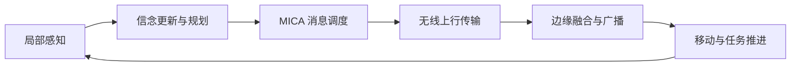

<div align="center">

# MICA

**Multiagent Information Coordination Architecture**

面向异构智能体团队的语义通信与协作实验平台。

[](https://github.com/NyxFelineLabs/mica-comm/actions/workflows/ci.yml)
[](pyproject.toml)
[](LICENSE)

[English](README.md) · **简体中文**

[快速开始](#快速开始) · [实验运行](#实验运行) · [实验结果](#实验结果) · [文档导航](#文档导航)

</div>

---

## 项目概览

MICA 研究无线资源受限时，智能体应该**传什么、何时传、以什么速率传**。
平台以搜索救援任务为载体，将局部感知、共享信念、传统规划器或 LLM 规划器，
以及面向任务价值的消息调度整合进可复现的仿真流程。

| 层次 | 支持内容 |
| --- | --- |
| 智能体团队 | 传统规划器与可选的 Ollama 本地 LLM 智能体 |
| 通信机制 | 证据、意图、确认消息、衰落信道与传输速率选择 |
| 实验评估 | 固定随机种子、基线、消融、独立测试集校准与资源统计 |



项目与方法统一称为 **MICA**。GitHub 仓库和 Python 发行包名为 `mica-comm`，
Python 导入包名为 `mica_comm`，主要通信策略 ID 为 `mica`。

## 快速开始

需要 Python 3.9 或更新版本。默认任务不需要 LLM 服务或 GPU。

```bash
git clone https://github.com/NyxFelineLabs/mica-comm.git
cd mica-comm
python -m venv .venv
source .venv/bin/activate
python -m pip install -e ".[dev]"
python -m mica_comm.simulator --scheme mica --seed 0
```

Windows PowerShell 使用 `.\.venv\Scripts\Activate.ps1` 激活环境。
已有可用环境时，可以跳过环境创建，直接用该环境的 Python 安装项目。

默认 seed-0 任务应在 **122 个时隙**完成，使用 **13,304 个上行符号**。
这两个数值用于软件回归检查，不代表性能优势。
安装后的 `mica-mission --scheme mica --seed 0` 命令与上述运行方式等价。

<details>
<summary><strong>Python 调用示例</strong></summary>

```python
from mica_comm import Config, run_episode

config = Config().with_(symbols_per_slot=50)
result = run_episode(config, scheme="mica", seed=0)
print(result["completion_time"], result["symbols"])
```

</details>

## 实验运行

激活环境后，在仓库根目录运行以下命令。

| 实验目的 | 命令 |
| --- | --- |
| 基线小规模检查 | `python -m experiments.run_all --only default --seeds 2` |
| 通信模块消融 | `python -m experiments.run_robustness --only ablation --seeds 2` |
| 三模型团队主实验 | `python -m experiments.run_team_benchmark --seeds 12` |
| 传统规划器的队友行为校准 | `python -m experiments.run_behavior_calibration --train-seeds 16 --eval-seeds 30 --workers 4` |
| LLM 团队的队友行为校准 | `python -m experiments.run_llm_calibration --models qwen3:8b llama3.1:8b` |

三模型主实验要求 Ollama 已安装 `qwen3:8b`、`llama3.1:8b` 和 `gemma3:12b`。
每个模型分别组成一个含 3 个 LLM 智能体与 3 个传统规划器的团队，
使用相同种子评估不同通信策略。出现模型调用回退时，实验会停止。
可选校准实验的详细协议单独记录在文档中。

WSL 调用 Windows Ollama 的方法见 [LLM 实验协议](docs/llm_behavior_calibration.md)，
其中包含使用已有 Windows Python 的桥接方式。通用客户端通过 `MICA_OLLAMA_URL`
接收完整的 `/api/generate` 地址；校准脚本的 `--url` 参数则接收服务基础地址。
模型别名和缓存说明见 [模型后端](docs/model_backends.md)。

实验产物保存在本地，不进入 Git：

```text
results/    逐种子记录、汇总、冻结的校准参数与 LLM 响应缓存
figures/    生成的分析图表
```

可以用 `MICA_RESULTS_DIR`、`MICA_FIGURES_DIR` 和 `MICA_CACHE_DIR` 重定向标准输出目录。
比较策略时须使用相同配置与种子集合，并区分仿真时隙和实际推理耗时。

## 实验结果

三模型主实验直接报告周期语义上报（`sem`）、MICA（`mica`）和理想投递参考（`genie`）
的任务指标。完成时隙衡量仿真任务时长，上行符号数衡量实际通信用量。
理想投递不经过等价的无线传输，其通信成本不与另外两种策略直接比较。

默认场景，每种模型与策略使用 12 个种子（`8000..8011`）：

| 模型 | 通信策略 | 平均完成时隙 | 平均上行符号数 | 完成率 |
| --- | --- | ---: | ---: | ---: |
| Qwen3 8B | 周期语义上报 | 81.33 | 42,307.75 | 100% |
| Qwen3 8B | MICA | 88.50 | 15,336.75 | 100% |
| Qwen3 8B | 理想投递参考 | 72.08 | 不适用 | 100% |
| Llama 3.1 8B | 周期语义上报 | 101.17 | 53,726.33 | 100% |
| Llama 3.1 8B | MICA | 80.08 | 13,819.92 | 100% |
| Llama 3.1 8B | 理想投递参考 | 82.08 | 不适用 | 100% |
| Gemma 3 12B | 周期语义上报 | 100.67 | 54,086.17 | 100% |
| Gemma 3 12B | MICA | 69.42 | 12,422.75 | 100% |
| Gemma 3 12B | 理想投递参考 | 69.92 | 不适用 | 100% |

108 次任务全部完成，模型后端回退为零。每个团队包含 3 个使用所选 LLM 的智能体
和 3 个传统规划器。上述结果为探索性实验均值，仿真时隙不代表在线推理耗时。
实验协议与结果表格见 [三模型团队实验](docs/team_benchmark.md)。
缓存回放耗时不能作为在线推理加速的证据。

## 项目结构

```text
mica-comm/
├── src/mica_comm/       仿真器、规划器、信道、消息与 MICA 调度器
├── experiments/         实验运行、分析与绘图
├── scripts/             单项任务与缓存工具
├── tests/               单元测试与回归测试
├── docs/                架构、实验协议与实测结果
└── .github/workflows/   持续集成
```

可复用方法放在 `src/mica_comm/`，实验组织放在 `experiments/`。
模型响应和生成的任务记录不提交到仓库。

## 文档导航

以下详细文档目前使用英文。

| 文档 | 内容 |
| --- | --- |
| [项目架构](docs/architecture.md) | 仿真流程、模块划分与扩展入口 |
| [实验工作流](docs/experiments.md) | 参数扫描、策略 ID、公平对比与输出约定 |
| [模型后端](docs/model_backends.md) | Ollama、模型别名与响应缓存 |
| [三模型团队实验](docs/team_benchmark.md) | 三种 LLM、通信策略与任务指标 |
| [行为模型校准](docs/behavior_calibration.md) | 队友 softmax 参数拟合与假设 |
| [LLM 校准协议](docs/llm_behavior_calibration.md) | 独立测试集评估与 Windows/WSL 推理 |
| [贡献指南](CONTRIBUTING.md) | 开发约定与检查命令 |

开发检查：

```bash
black --check src tests experiments scripts
ruff check src tests experiments scripts
python -m pytest -q
```

**已有工作副本升级：** Python 导入、命令行入口和项目环境变量现统一为
`mica_comm`、`mica-mission` 和 `MICA_`。请重新执行可编辑安装，并更新 Shell 配置。
已有实验数据会保留；重命名改变了源码哈希，校验源码的实验需要使用新的输出目录。

## 开源许可

采用 MIT 许可证。版权及代码来源见 [LICENSE](LICENSE) 与 [NOTICE](NOTICE.md)。
发表实验结果时，请记录代码版本、配置、模型摘要与种子集合。
