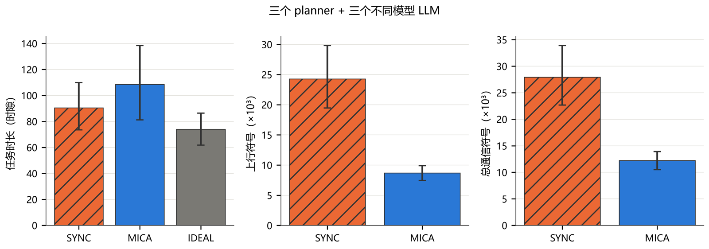

<div align="center">

# MICA

**Multiagent Information Coordination Architecture**

面向异构搜索救援团队的任务导向语义通信实验平台。

[](https://github.com/NyxFelineLabs/mica-comm/actions/workflows/ci.yml)
[](pyproject.toml)

[English](README.md) · **简体中文**

[项目概览](#项目概览) · [当前基线](#当前基线) · [开始使用](#开始使用) · [仓库结构](#仓库结构)

</div>

## 项目概览

MICA 研究**智能体该共享什么、何时通信，以及如何使用有限信道**。在网格搜索救援任务中，智能体观察周围环境、交换证据与意图，并根据共享信息调整后续计划。

`mica` 策略估计消息对队友搜索决策的作用，再结合投递概率与符号成本决定是否发送。实现支持经典规划器和通过 Ollama 接入的本地 LLM；默认消息价值模型为 EToM，配合精确动态规划调度器。

## 当前基线

当前团队由**三个经典规划器**与 **Qwen3 8B、Llama 3.1 8B、Gemma 3 12B** 组成。完整实验覆盖 **1,380 次任务**，全部通过校验，**后端回退为零**。

在共享上行预算为每时隙 300 符号的代表性设置中，12 个相同种子下，MICA 平均使用 **8,686 个上行符号**，定时共享使用 **24,267 个**；平均任务时长分别为 **108.5 和 90.5 个仿真时隙**。这一设置中通信开销更低，但平均任务时长更长。其他配置与不确定性区间见[完整混编团队结果](reports/current_mixed/README.md)。



## 开始使用

使用 Python 3.9 或更新版本安装，然后运行无需 LLM 服务的纯规划器任务：

```bash
python -m pip install -e ".[dev]"
mica-mission --team planner --scheme mica --seed 9000
```

默认混编团队需要本地 Ollama 提供 `qwen3:8b`、`llama3.1:8b` 和 `gemma3:12b`。运行 `mica-mission --help` 可查看团队、信道和任务选项。

## 仓库结构

| 路径 | 内容 |
| --- | --- |
| `src/mica_comm/` | 智能体、通信策略、世界模型和仿真 |
| `experiments/` | 实验入口与分析 |
| `tests/` | 行为、协议与结果完整性测试 |
| `reports/current_mixed/` | 当前实验结果与配套数据 |

每次推送和拉取请求都会在 Python 3.11 环境中运行 Black、Ruff 和 pytest。这些 CI 检查无需 Ollama；完整 LLM 实验单独运行。
