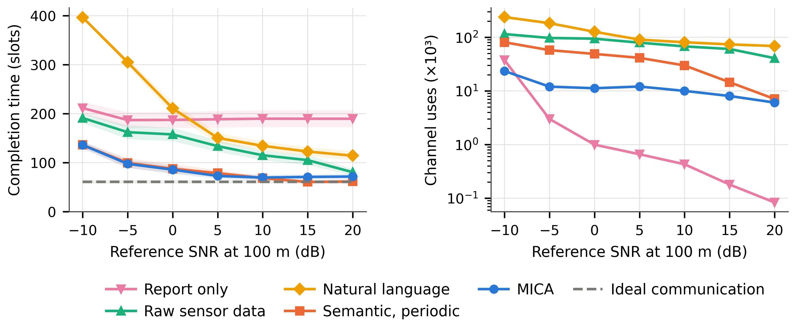
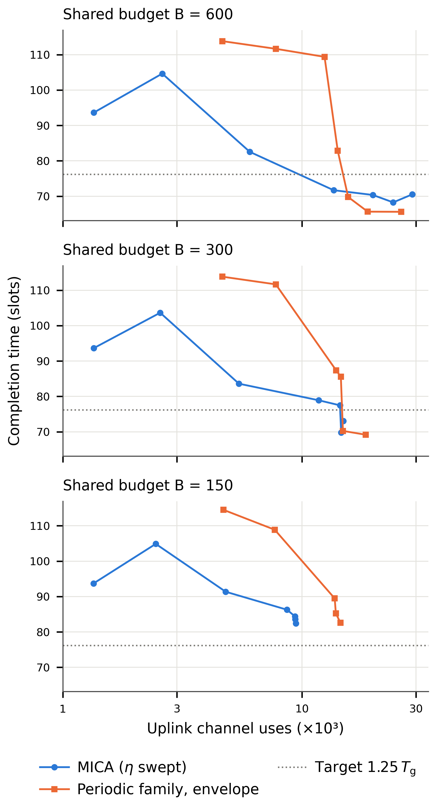

# Complete experiment figure suite

All 17 PDFs below were rerendered from historical experiment records.
They are not new MICA/LLM measurements. See [provenance](provenance.json),
[QA records](qa.json), [rebuild instructions](../../figures.md) and
[source attribution](../../../NOTICE.md).

| PDF | Content |
| --- | --- |
| [fig_agents.pdf](fig_agents.pdf) | Team-size sweep |
| [fig_budget.pdf](fig_budget.pdf) | Per-agent communication budget |
| [fig_curve.pdf](fig_curve.pdf) | Search progress over time |
| [fig_downlink.pdf](fig_downlink.pdf) | Downlink loss and delay |
| [fig_efficiency.pdf](fig_efficiency.pdf) | Task performance versus uplink resources |
| [fig_fbl.pdf](fig_fbl.pdf) | Finite-blocklength channel model |
| [fig_frontier.pdf](fig_frontier.pdf) | Value-rule resource frontiers |
| [fig_noise.pdf](fig_noise.pdf) | Sensitivity to value-estimation errors |
| [fig_pareto.pdf](fig_pareto.pdf) | Communication price trade-off |
| [fig_rescue.pdf](fig_rescue.pdf) | Rescue success versus uplink resources |
| [fig_shared_col.pdf](fig_shared_col.pdf) | Shared-budget frontiers, single column |
| [fig_shared.pdf](fig_shared.pdf) | Shared-budget frontiers |
| [fig_snr_pair.pdf](fig_snr_pair.pdf) | SNR: task performance and channel use |
| [fig_snr_sym.pdf](fig_snr_sym.pdf) | SNR: channel use |
| [fig_snr.pdf](fig_snr.pdf) | SNR: task performance |
| [fig_traj.pdf](fig_traj.pdf) | Example agent trajectories |
| [fig_where_tom.pdf](fig_where_tom.pdf) | Larger teams and clustered survivors |

## Previews

