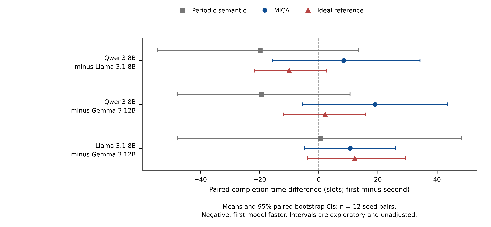

# Choosing the three LLM backends

## Recommendation

Keep **Qwen3 8B, Llama 3.1 8B, and Gemma 3 12B** for the current main study.
Describe them as **two approximately 8B backends and one larger approximately
12B backend, across three families**. Their sizes do not define a low/medium/high
intelligence ladder. This is a backend-robustness study: both family and size
change in the Gemma comparison, so a pure model-family effect is not identified.
Model quality and resource efficiency require separate measurements.

The exact positioning, checked against the installed Ollama `/api/show` metadata
on 2026-10-18, is:

| Installed tag | Main GGUF parameter count | Transformer blocks | Quantization | Experimental role |
| --- | ---: | ---: | --- | --- |
| `llama3.1:8b` | 8,030,261,312 (8.030B) | 32 | Q4_K_M | Approximately 8B comparison backend |
| `qwen3:8b` | 8,190,735,360 (8.191B) | 36 | Q4_K_M | Approximately 8B comparison backend; thinking disabled |
| `gemma3:12b` | 11,765,792,256 (11.766B) | 48 | Q4_K_M | Larger backend for validation across size and family |

Qwen has about 2.0% more parameters than Llama. Gemma has about 46.5% more
than Llama and 43.6% more than Qwen. Counts describe the main GGUF model;
Gemma's separate vision projector is not added to this table, and the current
task uses text only. Disk size, parameter count, runtime VRAM and latency are
different quantities. Matching Q4_K_M labels does not equalize the architectures
or runtime costs. In particular, Qwen is not the smallest model in this set.

Do not assign Qwen a generic cheap/low-resource label, or designate Llama the
primary scientific backend based on these twelve test seeds. Report all three.
The lower observed Qwen request duration below is a workload-specific timing
observation, not its experimental role. No configuration defaults or model tags
are changed by this analysis.

## What the current evidence says

Each entry averages twelve default-scene missions. Lower slots are better.

| Model | Periodic semantic | MICA | Ideal delivery | MICA server seconds / online request |
| --- | ---: | ---: | ---: | ---: |
| Qwen3 8B | 81.33 | 88.50 | 72.08 | 0.250 |
| Llama 3.1 8B | 101.17 | 80.08 | 82.08 | 0.372 |
| Gemma 3 12B | 100.67 | 69.42 | 69.92 | 0.780 |

The last column is total recorded server duration divided by actual HTTP
requests under MICA; it excludes cache hits and warmup. It is descriptive,
not a controlled latency benchmark: prompts, decoding lengths and runtime
context allocations differ, and each model ran in a different sequential
block. Cached mission wall time must not be used to rank online throughput.

The claim “Llama 3.1 outperforms Qwen3” depends on the communication policy.
Paired Llama-minus-Qwen completion differences, with 10,000 bootstrap seed
resamples and fixed resampling seed 5821, are:

| Policy | Mean difference (slots) | Exploratory 95% interval |
| --- | ---: | --- |
| Periodic semantic | +19.83 | [-13.58, +54.50] |
| MICA | -8.42 | [-34.25, +15.59] |
| Ideal delivery | +10.00 | [-2.67, +21.83] |

All intervals include zero. All nine pairwise model-by-policy intervals in the
current cohort include zero, including Gemma's comparisons. This does not show
that the models are equivalent; it means these twelve seed pairs do not resolve
the ranking. Intervals are unadjusted and exploratory, with no significance
tests or multiple-comparison claims. See the generated `statistics.json` and
the [public mission source data](data/team_benchmark/missions.csv).

Mission completion is a measure of the entire planner/communication system.
The LLM selects a short structured action from candidates; it is not being
tested on general language understanding or unrestricted reasoning. A model's
instruction following and exploration choices can interact with the timing of
shared information. The present data identify this interaction pattern, but
do not isolate its mechanism.

Qwen3's reasoning is disabled (`think: false`) under the shared 12-output-token
budget. These results describe that constrained mode. Gemma has approximately
11.77B parameters and an actual 2048-token context allocation, versus roughly
8B and 1024 for the others;
all prompts fit. Neither model-family effects nor parameter efficiency can be
isolated by this comparison.

## A defensible next experiment

1. Freeze the three model tags, quantization, prompt, candidate construction
   and non-reasoning generation budget. Test reasoning separately with a
   suitable output budget and reasoning cost accounting.
2. Keep the current twelve seeds as exploratory development evidence. Before
   another run, freeze the primary endpoint, configuration and seed cohorts.
   Use at least 30 fresh paired seeds per scene, covering default, clustered,
   bandwidth-limited and weak-link scenes. Thirty is a practical starting
   point, not a guarantee of adequate statistical power.
3. If the aim is **resource scaling**, run a separate same-family size series,
   for example Qwen3 4B/8B/14B with thinking disabled throughout. Measure peak
   VRAM, per-request latency and task outcomes; load sequentially on the 3090.
   This is an optional new experiment, not a reason to replace models after
   inspecting test scores. A same-family series reduces family confounding
   but still does not guarantee monotonic task performance with model size.
4. If the aim is **mixed-family cooperation**, first add per-agent backend
   configuration. The current benchmark uses one LLM family per mission and
   cannot establish a useful mixture of the three. Select role assignments on
   separate validation seeds, then compare the frozen mixed assignment with
   homogeneous teams on fresh tests, accounting for inference and model-switch
   overhead. A Gemma coordinator or Qwen scout is only a hypothesis until
   tested; the simulator currently has no such assigned LLM roles.

Do not remove a backend because its result weakens a preferred conclusion.
For the current communication-method study, cross-family replication with the
existing three models is the most direct next step.
